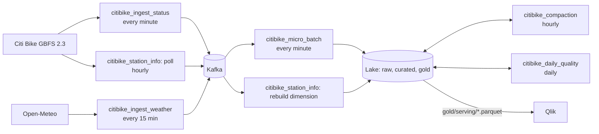

# Real-time Citi Bike availability with weather context

Stream-Visualization pipeline for ECE 5874 (Fall 2026). Citi Bike station availability (GBFS 2.3) and Open-Meteo
weather are polled into Kafka, processed in one-minute micro-batches into a Parquet lake (a local Docker volume or
AWS S3), and served to a Qlik dashboard. Everything that runs is an **Airflow DAG**: ingest into Kafka and
processing out of it.

Stack: Python 3.9, Airflow 2.7.3, Kafka (Confluent 7.5), Parquet via pyarrow.

**[mise](https://mise.jdx.dev/) is the interface to the project.** Every command you run is a mise task;
`mise tasks` lists them. mise also provides Python and [uv](https://docs.astral.sh/uv/). uv is the package
manager the tasks use underneath; you don't call it directly.



## Quick start

1. Open the folder in VS Code and choose **Reopen in Container**. The whole stack starts with the window and stops
   when it closes. State lives in named volumes, so Kafka's log, Airflow's database and the local lake survive
   stop/start and rebuilds.
2. Wait for Airflow at http://localhost:8080 (admin / admin, dev only). Every DAG starts unpaused.
3. On the first start, `citibike_setup` creates the Kafka topics. For a minute or two, ingest and micro-batch
   runs can fail because the topics don't exist yet; they recover on their own.
4. Check the pipeline from the dev shell:

```bash
mise run broker:check      # broker reachable and all five topics exist
mise run status            # lake health: last batch age, stations, at-risk counts, latency (fails if stale)
```

| Service | What it does |
|---|---|
| `airflow` | runs every DAG (LocalExecutor, standalone) |
| `kafka`, `zookeeper` | the broker; topic auto-create is off, so topics come only from `citibike_setup` |
| `postgres` | Airflow metadata |
| `volume-init` | makes the lake and log volumes writable by the airflow user |
| `app` | the dev shell (devcontainer Python image plus the mise feature); no pipeline code runs here |

Closing VS Code or a sleeping laptop stops the pipeline. The missed polls show up as gaps in the daily quality
report; Kafka keeps 21 days, so the micro-batch catches up on whatever was ingested.

## DAGs

| DAG | Schedule | What it does | Retries |
|---|---|---|---|
| `citibike_setup` | once | creates the Kafka topics; safe to re-trigger after a broker reset | 5 |
| `citibike_ingest_status` | every minute | polls station_status, one Kafka message per station | none |
| `citibike_ingest_weather` | every 15 min | polls Open-Meteo current conditions | 2 |
| `citibike_station_info` | :05 hourly | polls station_information, then rebuilds the station dimension | 2 |
| `citibike_micro_batch` | every minute | plan → process → metrics → finalize (see Design) | 2 |
| `citibike_compaction` | :20 hourly | merges each completed hour's per-minute files into one | 1 |
| `citibike_daily_quality` | 00:30 UTC | quality report for the previous UTC day | 1 |
| `citibike_replay` | manual | replays a capture into Kafka | none |

How ingest behaves:

- Each run polls once. A failed poll is recorded in `pipeline.poll_log` and the task goes red.
- `citibike_ingest_status` doesn't retry: the next run is a minute away, and a retry would poll twice.
- The dimension rebuild runs even when the station_info poll fails, because the compacted topic still holds the last
  good snapshot.
- State that has to outlive a task run is kept in XCom: the discovered feed URLs, the last feed timestamp (so an
  unchanged feed isn't republished) and the failure count.

Trigger any DAG from the dev shell through the Airflow REST API:

```bash
mise run dag:trigger citibike_setup
mise run dag:trigger citibike_replay '{"path": "/opt/airflow/data/capture", "speed": 60}'
```

## The lake

The same layout is used locally (`/opt/airflow/data` in Airflow, mounted read-only at `/lake` in the dev shell) and
on S3 (under `s3://$CB_S3_BUCKET/$CB_S3_PREFIX/`). Data files are partitioned by event hour: `dt=YYYY-MM-DD/hr=HH/`.

| Path | Contents |
|---|---|
| `raw/{station_status,weather,poll_log}/` | records as received, with Kafka topic/partition/offset and the lossless payload |
| `curated/station_status/`, `curated/weather/` | deduplicated, validated, flagged, joined with the station dimension and as-of weather |
| `curated/dim_station/` | station dimension: `current.parquet` plus hourly snapshots |
| `gold/station_window_15m/`, `gold/system_availability_5m/` | per-station window metrics, system-wide availability |
| `gold/serving/` | **what Qlik reads**, overwritten every batch: `current_station_state`, `at_risk`, `system_summary`, `batch_log_recent` |
| `dlq/` | invalid records with reason codes |
| `quality/daily/dt=YYYY-MM-DD/` | `report.json` and `report.md` |
| `ops/batch_plan/`, `ops/batch_log/` | per-run offset plans and the batch history |

## Configuration

All settings are `CB_*` environment variables with working defaults. To change them, copy
`.devcontainer/.env.example` to `.devcontainer/.env` (gitignored) and rebuild the container.

| Variable | Default | Purpose |
|---|---|---|
| `CB_STORAGE` | `local` | `local` or `s3`; S3 also needs `CB_S3_BUCKET`, `CB_S3_PREFIX` and AWS credentials |
| `CB_CAPTURE_DIR` | unset | record everything the ingest DAGs publish (see Sample data) |
| `CB_STALE_MINUTES` | 30 | a station whose `last_reported` is older than this is stale |
| `CB_WINDOW_MINUTES` | 15 | trailing window for rate metrics |
| `CB_RISK_HORIZON_MINUTES` | 30 | flag `at_risk` when empty or full is predicted within this many minutes |
| `CB_NOISE_FLOOR_BIKES` | 2 | minimum net change before a station can be flagged |
| `CB_STATUS_INTERVAL_S` | 60 | expected poll interval for completeness; must match the ingest schedule |
| `CB_GAP_THRESHOLD_S` | 150 | a silence longer than this counts as a gap |
| `CB_WEATHER_LAT`, `CB_WEATHER_LON` | Midtown Manhattan | weather location |

The full list, with comments, is in `citibike_producer/config.py` and `citibike_pipeline/config.py`.

## Sample data and replay

`data/sample/sample_capture.jsonl.gz` is **synthetic**: 40 stations over 45 minutes at one poll a minute. It
includes a depleting, a filling, an empty, a stale, an offline, an invalid and an unknown station. It is built by
the real producer jobs against simulated HTTP, so its envelopes match live data exactly. **Replace it with a real
capture before submitting.**

```bash
mise run kafka:replay         # replay the committed sample through Kafka at 60x (citibike_replay DAG)
mise run capture:synthetic    # regenerate the synthetic sample
```

To record a **real** capture:

1. Set `CB_CAPTURE_DIR=/opt/airflow/data/capture` in `.devcontainer/.env` and rebuild.
2. Each ingest DAG appends what it publishes to its own `<job>.jsonl.gz` in that directory. You can see the files
   at `/lake/capture` in the dev shell.
3. Replay the directory with the `citibike_replay` DAG; its files are merged in event-time order.

Replay into a clean lake. Serving time never moves backwards, so replaying older data over live data is ignored.

## Design

- **Event envelope on every message:**
  - schema version, `poll_id`, source URL, GBFS version
  - source timestamp (`feed_last_updated`) and ingest timestamp (`fetched_at`)
  - producer version and payload

  `pipeline.poll_log` records every poll attempt: outcome, HTTP latency and delivery counts.
- **Exactly the planned offsets, committed last.**
  - `plan_batch` writes `ops/batch_plan/<run_id>.json` once.
  - A retry reuses that plan, so it re-reads the same offsets and overwrites the same keys, which are derived from a
    hash of the offset ranges.
  - Kafka offsets are committed in `finalize`, after every output exists.
- **Event time everywhere.** Windows and `as_of` come from observation times, never the wall clock, so replay
  behaves like live. Latency is the time the serving files were written minus `fetched_at` (or minus `replayed_at`
  during replay).
- **Rate extrapolation, no ML.** Over the trailing window the pipeline computes net change, rate per minute, and
  minutes to empty or full. A station is `at_risk` when empty or full is within the risk horizon and the change is
  at least the noise floor.
- **Provenance.** Feed URLs come from the GBFS discovery file and are never hardcoded. Every row carries
  `source_url`, `gbfs_version`, `poll_id`, `producer_version`, `batch_id` and its Kafka topic/partition/offset.

## Project layout

```
citibike_contract/   topic names, event types, envelope schema version, timestamp format (stdlib only)
citibike_producer/   ingest library: polling jobs, Kafka sink, replay, synthetic capture, topic creation
citibike_pipeline/   processing library: micro-batch, metrics, validation, storage, compaction, quality
dags/                thin DAGs that call the libraries; shared settings in dags/_common.py
data/sample/         the committed (synthetic) sample capture
.devcontainer/       compose stack, dev container definition, Airflow image
tests/               unit tests, end-to-end over an in-memory broker, DAG parsing
```

The libraries import nothing from Airflow, so all the processing logic can be tested without a scheduler.

## Development

```bash
mise run test       # all tests; no broker or network needed
mise run lint       # ruff
mise run sync       # install the locked dependencies (the dev container does this on create)
mise run lock       # re-resolve uv.lock after changing dependencies in pyproject.toml
mise tasks          # everything else: peeking at topics, triggering DAGs, regenerating the sample
```

When the dev container is created it runs `mise trust`, `mise install` (Python and uv, as pinned in
`mise.toml`) and `mise run sync`.

The DAG-parsing tests (`tests/test_dags.py`) skip unless Airflow is installed. Airflow isn't a project dependency
because it has to be installed with its constraints file. To run them, install `apache-airflow==2.7.3` into a
separate environment using Airflow's constraints for Python 3.9.

## Known limitations and assumptions

- **One poll a minute.** Airflow can't schedule more often, so station_status is polled every 60 s rather than the
  30 s in the proposal.
- **Stale threshold (30 min) is an assumption.** Quiet stations may legitimately not report for a long time. Tune
  `CB_STALE_MINUTES` from the age distribution in the daily report.
- **Qlik refresh is unverified.** The one-minute dashboard refresh and the two-minute latency target depend on how
  often the course's Qlik can reload. The pipeline's own latency is measured in `batch_log`.
- `current_station_state` contains stations seen in the last 30 minutes, so a station that disappears from the feed
  drops out of the serving file.
- Window metrics use the first and last observation, so they are sensitive to single-bike noise (hence the noise
  floor).
- Compaction only touches hours that ended at least 2 hours ago. It skips `dlq/`, `gold/` and `ops/`, and
  `ops/batch_plan/` is never pruned (about 1,440 files a day).
- Credentials (admin / admin, Postgres airflow / airflow, basic auth on the REST API) are for local development only.
- The tests don't cover a real broker, the Docker images or Qlik.
