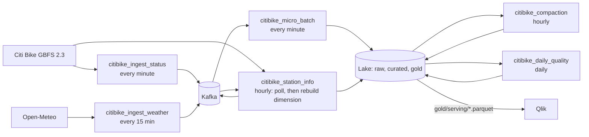

# Real-time Citi Bike availability with weather context

Stream-Visualization pipeline (ECE 5874, Fall 2026): Python 3.9, Kafka, Airflow, Parquet lake (local volume or
AWS S3), Qlik dashboard. Package manager: [uv](https://docs.astral.sh/uv/). Everything that runs is an Airflow DAG,
both ingest into Kafka and processing out of it.



## Run it

Open the folder in VS Code and choose **Reopen in Container**. The whole stack starts with the window and stops
when it closes (`shutdownAction: stopCompose`); state lives in named volumes, so Kafka's log, Postgres, and the
local lake survive stop/start and rebuilds.

| Service | What it does |
|---|---|
| `airflow` | Airflow 2.7.3 on Python 3.9 running every DAG, UI at http://localhost:8080 (admin / admin, dev only) |
| `kafka`, `zookeeper` | the broker (topic auto-create is off; `citibike_setup` creates them) |
| `postgres` | Airflow metadata |
| `volume-init` | makes the lake and log volumes writable by the airflow user |
| `app` | the dev shell (no pipeline code runs here) |

| DAG | Schedule | What it does |
|---|---|---|
| `citibike_setup` | once | create the Kafka topics (idempotent; re-trigger after a broker reset) |
| `citibike_ingest_status` | every minute | poll station_status, one message per station |
| `citibike_ingest_weather` | every 15 min | poll Open-Meteo current conditions |
| `citibike_station_info` | hourly | poll station_information, then rebuild the station dimension |
| `citibike_micro_batch` | every minute | Kafka offsets → validated, enriched lake layers and serving files |
| `citibike_compaction` | hourly | merge per-minute files of completed hours |
| `citibike_daily_quality` | daily 00:30 UTC | quality report for the previous day |
| `citibike_replay` | manual | replay a capture into Kafka |

Ingest polls do not retry inside a run: a failed poll is recorded in `pipeline.poll_log` and the task goes red.
`station_status` runs every minute without retries (a retry would double-poll); weather and station_info retry twice.
Producer state that must outlive a task (discovered feed URLs, last feed timestamp, failure count) is kept in XCom.

```bash
uv run citibike-status                 # lake health: last batch age, stations, at-risk counts, latency
mise run broker:check                  # broker reachable and all topics exist
mise run dag:trigger <dag_id> ['<conf>']  # trigger any DAG through the Airflow REST API
uv run pytest                          # no broker or network needed (DAG tests skip without Airflow)
mise run lint                          # ruff
```

The lake defaults to a docker volume (`/opt/airflow/data` in Airflow, `/lake` read-only in the dev shell).
For AWS S3, copy `.devcontainer/.env.example` to `.devcontainer/.env` and rebuild.

Gaps from closing VS Code or a sleeping laptop are expected: they appear in `pipeline.poll_log` and in the
daily quality report as completeness below 100% and listed gaps.

## Replay (no network needed)

```bash
mise run kafka:replay                           # citibike_replay DAG: the committed sample at 60x
mise run capture:synthetic                      # regenerate the synthetic sample (built by the real producer jobs)
```

To cut a **real** sample, set `CB_CAPTURE_DIR=/opt/airflow/data/capture` in `.devcontainer/.env` and rebuild. Each
ingest DAG then appends what it publishes to its own `<job>.jsonl.gz` there (visible at `/lake/capture` in the dev
shell). Replay the directory with `mise run dag:trigger citibike_replay '{"path": "/opt/airflow/data/capture"}'`;
its files are merged in event-time order.

`data/sample/sample_capture.jsonl.gz` is **synthetic** (40 stations, 45 minutes at one poll a minute, with a depleting, a filling, an
empty, a stale, an offline, an invalid, and an unknown station). Replace it with a real capture before submitting.
Replay into a clean lake: serving time never moves backwards, so replaying older data over live data is ignored.

## Design

- **Event envelope** on every message: schema version, `poll_id`, source URL, GBFS version, source timestamp
  (`feed_last_updated`), ingest timestamp (`fetched_at`), producer version, payload. `pipeline.poll_log` records
  every poll attempt (outcome, latency, delivery counts).
- **Exactly the planned offsets, committed last.** `plan_batch` writes `ops/batch_plan/<run_id>.json` once. A retry
  reuses it, so the same offsets are re-read and the same keys (derived from a hash of the ranges) are overwritten.
  Kafka offsets are committed in `finalize`, after every output exists.
- **Event time everywhere.** Windows and `as_of` come from observation times, never the wall clock, so replay
  behaves like live. Latency is `serving write time - fetched_at` (or `replayed_at` in replay).
- **Layers.** `raw/` typed as received with Kafka coordinates and the lossless payload; `curated/` deduplicated,
  flagged (`is_stale`, `is_repeat`, `is_out_of_order`, `is_unknown_station`) and joined with the station
  dimension and as-of weather; `gold/` window metrics, system availability, and `gold/serving/*` (overwritten
  each batch, what Qlik reads). Invalid records go to `dlq/` with reason codes. Files are partitioned by the
  event hour of their rows.
- **Rate extrapolation, no ML.** Over a trailing 15-minute window: net change, rate per minute, minutes to empty or
  full, `at_risk` when within 30 minutes and the change is at least 2 bikes (`CB_*` variables tune all of it).

Provenance: feed URLs come from the GBFS discovery file (`gbfs.citibikenyc.com/gbfs/2.3/gbfs.json`); every row
carries `source_url`, `gbfs_version`, `poll_id`, `producer_version`, `batch_id`, and Kafka topic/partition/offset.

## Layout

```
citibike_contract/   topic names, event types, envelope schema version, timestamp format (stdlib only)
citibike_producer/   ingest library: polling jobs, Kafka sink, replay, synthetic capture, topic creation
citibike_pipeline/   processing library (no Airflow imports): batch, metrics, validation, storage, quality
dags/                eight thin DAGs that call the libraries; shared settings in dags/_common.py
.devcontainer/       compose stack and the Airflow image
tests/               unit, end-to-end (in-memory broker), DAG parsing
```

## Known limitations and assumptions to confirm

- **Stale threshold (30 min) is an assumption.** Quiet stations may legitimately not report for long. Tune
  `CB_STALE_MINUTES` from the age CDF in the daily report.
- **Qlik refresh.** The one-minute dashboard refresh and two-minute latency target depend on how often the
  course's Qlik can reload; unverified. The pipeline's own latency is measured in `batch_log`.
- `current_station_state` contains stations seen in the last 30 minutes; a station that disappears from the feed
  drops out of the serving file.
- Window metrics use first and last observation; they are sensitive to single-bike noise (noise floor 2).
- Compaction runs on hours ended at least 2 hours ago; daily compaction is not implemented.
- Not covered by the tests: a real broker, the Docker images, Qlik.
